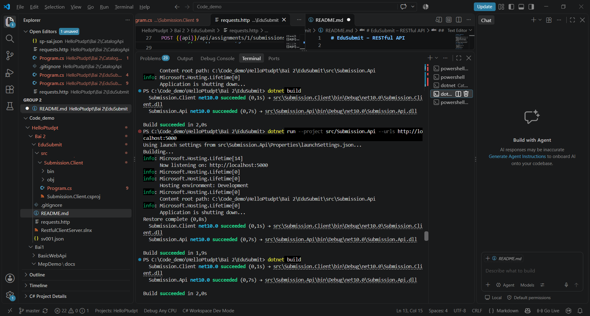
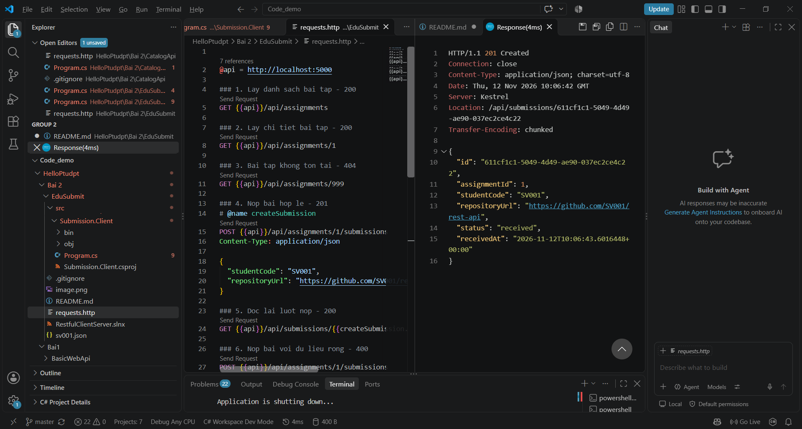
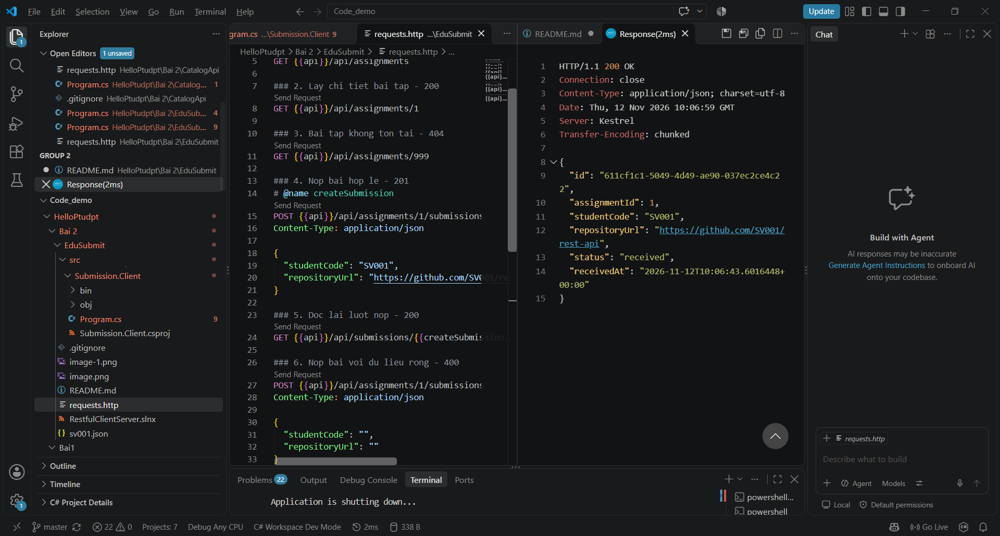
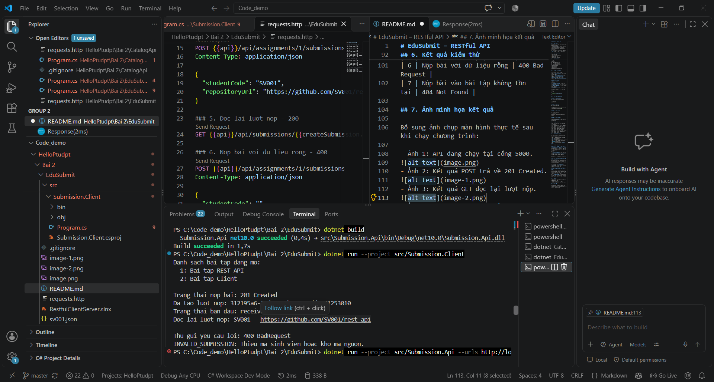
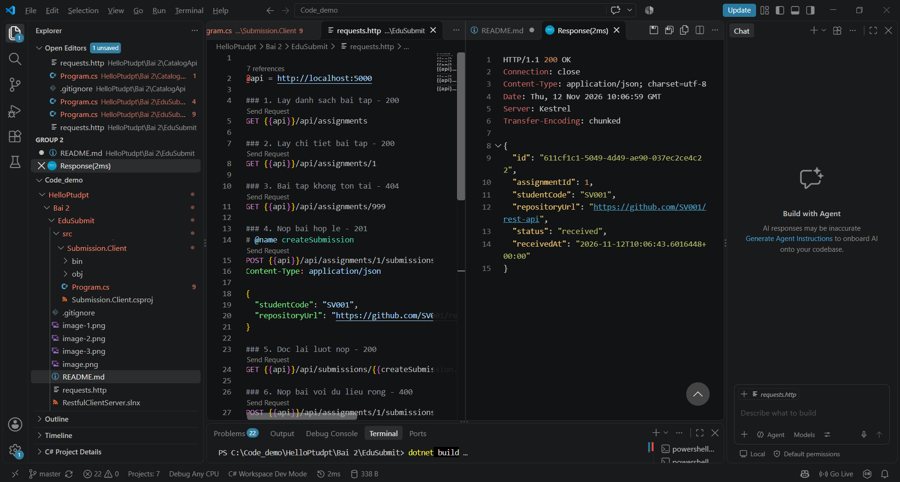

# EduSubmit – RESTful API

## 1. Giới thiệu

EduSubmit là ứng dụng minh họa kiến thức RESTful API, gồm:
- **Submission.Api:** Máy chủ API xử lý thông tin bài tập và lượt nộp bài.
- **Submission.Client:** Ứng dụng Console giao tiếp với API thông qua HttpClient.

Dữ liệu được lưu trong bộ nhớ RAM bằng `List`, không sử dụng cơ sở dữ liệu.

## 2. Công nghệ sử dụng

- C# / .NET 10
- ASP.NET Core Minimal API
- HttpClient
- System.Text.Json
- REST Client (VS Code)

## 3. Cấu trúc dự án

```text
EduSubmit/
├── src/
│   ├── Submission.Api/
│   │   └── Program.cs
│   └── Submission.Client/
│       └── Program.cs
├── requests.http
├── sv001.json
├── README.md
├── .gitignore
└── RestfulClientServer.slnx
```

## 4. Các API đã xây dựng

| Phương thức | URI | Kết quả |
|---|---|---|
| GET | `/api/assignments` | 200 – Danh sách bài tập |
| GET | `/api/assignments/{id}` | 200 / 404 |
| POST | `/api/assignments/{id}/submissions` | 201 / 400 / 404 |
| GET | `/api/submissions/{submissionId}` | 200 / 404 |

### Quy tắc xử lý lỗi

| Mã lỗi | Ý nghĩa |
|---|---|
| `ASSIGNMENT_NOT_FOUND` | Không tìm thấy bài tập |
| `ASSIGNMENT_CLOSED` | Bài tập đã đóng |
| `INVALID_SUBMISSION` | Dữ liệu nộp bài không hợp lệ |
| `SUBMISSION_NOT_FOUND` | Không tìm thấy lượt nộp |

Các lỗi do handler xử lý sử dụng cấu trúc:

```json
{
  "code": "INVALID_SUBMISSION",
  "message": "Thong bao loi"
}
```

## 5. Cách chạy chương trình

### Bước 1: Build solution

Mở Terminal tại thư mục EduSubmit:

```powershell
dotnet build
```

### Bước 2: Chạy API

Mở Terminal thứ nhất:

```powershell
dotnet run --project src/Submission.Api --urls http://localhost:5000
```

### Bước 3: Chạy Client

Mở Terminal thứ hai:

```powershell
dotnet run --project src/Submission.Client
```

### Bước 4: Kiểm thử API

Mở file `requests.http` bằng VS Code và nhấn **Send Request** để thực hiện các yêu cầu HTTP.

## 6. Kết quả kiểm thử

| STT | Nội dung kiểm thử | Mã trạng thái mong đợi |
|---|---|---|
| 1 | Lấy danh sách bài tập | 200 OK |
| 2 | Lấy chi tiết bài tập | 200 OK |
| 3 | Lấy bài tập không tồn tại | 404 Not Found |
| 4 | Nộp bài hợp lệ | 201 Created |
| 5 | Đọc lại lượt nộp | 200 OK |
| 6 | Nộp bài với dữ liệu rỗng | 400 Bad Request |
| 7 | Nộp bài vào bài tập không tồn tại | 404 Not Found |

## 7. Ảnh minh họa kết quả

Bổ sung ảnh chụp màn hình thực tế sau khi chạy chương trình:

- Ảnh 1: API đang chạy tại cổng 5000.

- Ảnh 2: Kết quả POST trả về 201 Created.

- Ảnh 3: Kết quả GET đọc lại lượt nộp.

- Ảnh 4: Client thực hiện đủ 4 nấc.

- Ảnh 5: Các request trong `requests.http`.


## 8. Câu hỏi tổng kết

### Câu 1. Vì sao URI sử dụng danh từ và hành động được thể hiện qua HTTP method?

URI đại diện cho tài nguyên mà API quản lý. HTTP method thể hiện hành động trên tài nguyên đó.

Ví dụ:
- `GET /api/assignments`: lấy danh sách bài tập.
- `POST /api/assignments/1/submissions`: tạo lượt nộp bài cho bài tập số 1.

Cách thiết kế này giúp URI nhất quán và dễ hiểu.

### Câu 2. Tính Stateless được thể hiện ở đâu trong code?

Mỗi request HTTP chứa đầy đủ thông tin cần thiết để máy chủ xử lý yêu cầu. Máy chủ không phụ thuộc vào trạng thái phiên làm việc của Client.

Ví dụ, Client gửi `assignmentId`, `studentCode` và `repositoryUrl` trong request POST. Máy chủ dựa vào những dữ liệu này để xử lý yêu cầu.

### Câu 3. Vì sao Client và Server có thể khai báo DTO riêng mà vẫn giao tiếp được?

Client và Server không cần dùng chung một lớp DTO. Hai bên chỉ cần thống nhất cấu trúc JSON, tên thuộc tính và kiểu dữ liệu khi gửi, nhận dữ liệu.

Ví dụ, `SubmissionDto` ở hai project có thể được khai báo riêng nhưng vẫn tương thích nếu các thuộc tính JSON tương ứng nhau.

## 9. Hạn chế

- Dữ liệu lưu trong RAM nên sẽ mất khi khởi động lại API.
- Chưa tích hợp cơ sở dữ liệu.
- Chưa triển khai xác thực người dùng.

## 10. Kết luận

Đã xây dựng và kiểm thử ứng dụng EduSubmit với 4 endpoint RESTful API, ứng dụng Client sử dụng HttpClient và bộ kiểm thử requests.http.